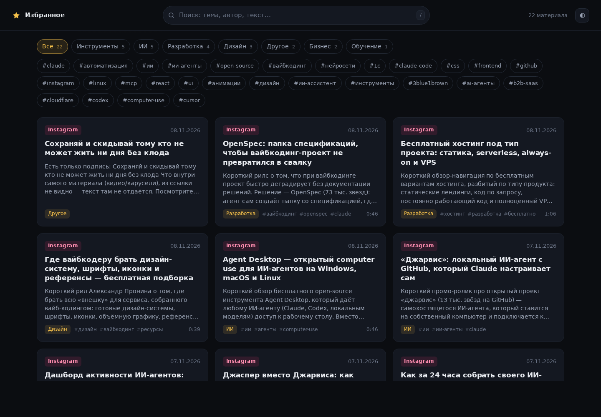
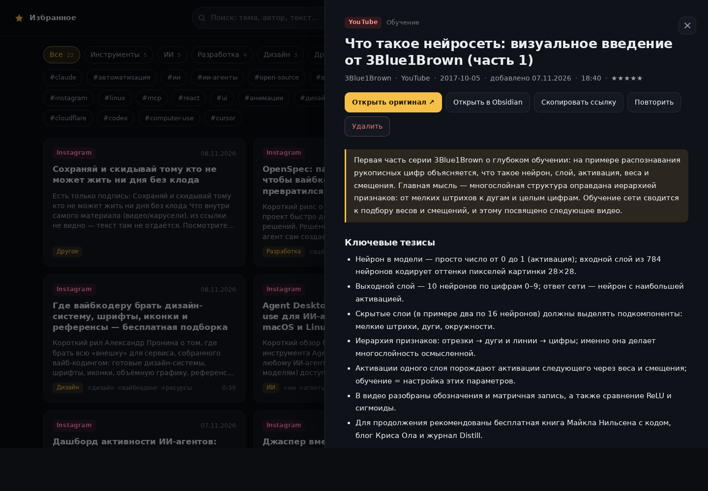
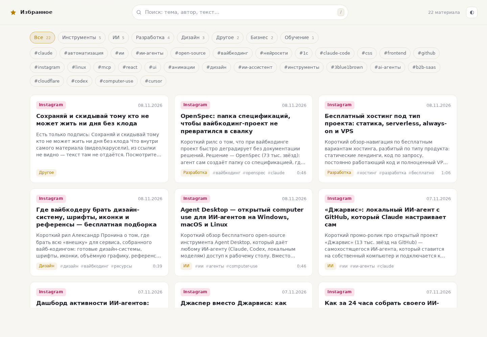

# Favourites

**Кидаешь боту ссылку — получаешь карточку в Obsidian и в веб-справочнике.**
Self-hosted pipeline: Telegram → извлечение контента → LLM-конспект → markdown-заметка.


[](https://github.com/mih-ap/favourites/actions/workflows/tests.yml)

Личная справочная для одного человека: статья, рилс, видео или пост с фото,
сохранённый в Telegram, превращается в заметку с переводом заголовка, выжимкой,
тезисами, тегами, категорией, цитатами и ответом на вопрос «зачем мне это».
Всё сохранённое ищется в веб-приложении — без облака, на своём железе.

## Скриншоты

| Справочник, тёмная тема | Карточка материала |
|---|---|
|  |  |
| Поиск по тексту, фильтры по категориям, облако тегов, бесконечная лента | Конспект, метаданные, ссылки на оригинал и в Obsidian, повторная обработка |

| Светлая тема |
|---|
|  |

## Как это работает

```
Telegram ──► bot ──► очередь (SQLite) ──► worker
                                           │ yt-dlp / trafilatura / oEmbed
                                           │ faster-whisper (если нет текста)
                                           │ LLM через OpenAI-совместимый API
                                           ▼
                        vault/library/<YYYY-MM>/<дата>-<slug>.md
                                           │
                          web ◄────────────┘  индексы из SQLite
```

1. Бот принимает ссылку (или пересланное сообщение), нормализует URL, отсекает
   дубликаты и кладёт запись в очередь. Сразу отвечает «принял».
2. Воркер забирает запись: видео и соцсети — через `yt-dlp` (метаданные +
   субтитры, включая автосубтитры), статьи — через `trafilatura` с разбором
   Open Graph как запасным вариантом. Если текста нет — расшифровывает звук
   локально (`faster-whisper`), без внешних сервисов.
3. Модель переводит заголовок на русский, делает выжимку, тезисы, теги,
   категорию, цитаты и «зачем мне это».
4. Карточка сохраняется в vault как обычная заметка Obsidian: frontmatter с
   тегами и ссылкой на источник, фото поста — рядом в `attachments/`,
   полный текст и транскрипт — внутри `<details>`.
5. Бот присылает уведомление со ссылкой на карточку в вебе.

## Что умеет

- **Источники:** YouTube, Instagram (посты, карусели, Reels), TikTok, VK, X,
  Telegram-посты и обычные статьи.
- **Ролики без субтитров:** локальный ASR (faster-whisper, int8) по звуковой
  дорожке — минутный рил расшифровывается за ~16 с на двух ядрах.
- **Фото и карусели** скачиваются в vault рядом с карточкой и вставляются в
  заметку разделом «Фото» (ссылки Instagram CDN живут часами, поэтому копия
  локальная).
- **Честная деградация:** если содержания меньше 200 символов (одна подпись или
  заголовок), модель не зовут — карточка помечается `status: partial` с
  причиной вместо правдоподобной выдумки.
- **Дедупликация** по нормализованному URL и повторные попытки с паузой
  (1 мин, затем 5 мин), `/retry` из бота и кнопка «Повторить» на сайте.
- **Веб-справочник** на стандартной библиотеке: поиск по тексту, категории,
  теги, читалка, «Открыть в Obsidian», удаление в `data/trash`.
- **Никакого облака:** своя SQLite, свой vault, свой LLM-endpoint (подойдёт
  LiteLLM, OpenRouter, Ollama, vLLM).

## Быстрый старт

Нужны Docker и compose-плагин; для запуска без docker — Python 3.13 и `ffmpeg`.

```bash
git clone https://github.com/mih-ap/favourites.git
cd favourites
cp .env.example .env
```

В `.env` минимум:

```dotenv
FAV_VAULT_DIR=/path/to/Obsidian/Vault   # куда писать карточки
FAV_VAULT_NAME=Vault                    # имя vault для ссылок obsidian://
FAV_PUBLIC_URL=http://localhost:8090     # адрес веба для ссылок в уведомлениях
FAV_LLM_BASE_URL=https://your-llm/v1
FAV_LLM_API_KEY=...
FAV_LLM_MODEL=Gemma-4-12B-it-qat-w4a16-ct   # любая модель вашего endpoint
```

```bash
docker compose up -d --build web worker      # веб + воркер
# бот — после того как появится токен:
docker compose --profile bot up -d bot
```

Веб: <http://localhost:8090>. Бот по умолчанию выключен профилем `bot`, чтобы
очередь можно было наполнять из CLI без Telegram.

### Токен бота

1. В Telegram: **@BotFather → /newbot**, имя любое, username заканчивается на `bot`.
2. Токен вида `123456789:AA...` — в `FAV_TELEGRAM_TOKEN`.
3. `/setprivacy → Disable`, чтобы бот видел ссылки в пересланных сообщениях и группах.
4. `docker compose --profile bot up -d bot && docker compose logs -f bot`.
5. Напишите боту `/start`. Если задан `FAV_ALLOWED_CHATS`, бот подскажет ваш
   chat_id — добавьте его в `.env` и перезапустите.

### Без docker

```bash
python -m venv .venv && . .venv/bin/activate
pip install -r requirements.txt
export FAV_VAULT=/path/to/vault FAV_DATA_DIR=./data
python -m app.web            # http://localhost:8090
python -m app.worker         # разбор очереди
```

## Настройка

Все параметры читаются из окружения; `.env` подхватывается автоматически.
Полный список с комментариями — в [`.env.example`](.env.example).

| Переменная | По умолчанию | Что делает |
|---|---|---|
| `FAV_VAULT_DIR` | `./vault` | каталог vault на хосте (в контейнере `/vault`) |
| `FAV_BIND` / `FAV_PORT` | `127.0.0.1` / `8090` | адрес веб-интерфейса |
| `FAV_PUBLIC_URL` | `http://localhost:8090` | ссылки в уведомлениях и `_index.md` |
| `FAV_LLM_BASE_URL` / `FAV_LLM_API_KEY` / `FAV_LLM_MODEL` | — | OpenAI-совместимый endpoint |
| `FAV_MIN_SUBSTANCE` | `200` | порог «содержания», ниже которого модель не зовут |
| `FAV_ASR_ENABLED` / `FAV_ASR_MODEL` | `1` / `small` | локальная расшифровка звука |
| `FAV_ASR_THREADS` / `FAV_ASR_MAX_SECONDS` | `2` / `600` | потоки и потолок длительности |
| `FAV_IMAGES` / `FAV_IMAGES_MAX` | `1` / `20` | фото постов и лимит картинок |
| `FAV_COOKIES_FILE` | `./data/instagram-cookies.txt` | cookies для Instagram |

## Команды бота

| Команда | Что делает |
|---|---|
| ссылка / пересланное сообщение | в очередь, ответ «принял» |
| `/list` | последние 10 материалов со ссылками на веб |
| `/stats` | сколько готово / в очереди / с ошибкой |
| `/retry N` | повторить обработку записи N |
| `/help` | подсказка |

## CLI

```bash
python -m app.cli add 'https://example.com/post' --note 'зачем сохранил'
python -m app.worker --once        # разобрать очередь
python -m app.worker --id 12       # переобработать запись
python -m app.cli list --limit 20
python -m app.web                  # локально, порт 8090
```

## API веб-приложения

| Метод | Путь | Назначение |
|---|---|---|
| GET | `/api/items?q=&tag=&category=&source=&limit=&offset=` | список карточек |
| GET | `/api/item?id=` | карточка + markdown |
| GET | `/api/tags`, `/api/facets`, `/api/stats` | фильтры и счётчики |
| GET | `/media/<путь внутри library>` | фото карточки |
| POST | `/api/requeue?id=` | вернуть в очередь |
| POST | `/api/delete?id=` | удалить (файл → `data/trash`) |
| GET | `/api/health` | состояние |

## Структура

| Путь | Что |
|---|---|
| `app/extract.py` | извлечение: yt-dlp, trafilatura, oEmbed, фото постов, вызов ASR |
| `app/analyze.py` | промпт и вызов модели, порог `MIN_SUBSTANCE` |
| `app/asr.py` | yt-dlp → ffmpeg → faster-whisper |
| `app/vault.py` | markdown-карточка, фото в `attachments/`, `_index.md` |
| `app/db.py` | очередь SQLite, нормализация URL |
| `app/worker.py` | claim → process → notify, backoff на ошибках |
| `app/bot.py`, `app/telegram.py` | Telegram-бот и отправка сообщений |
| `app/web.py` | веб-справочник и API (stdlib) |
| `web/static/` | интерфейс: HTML, CSS, JS, локальный `marked` |
| `tests/test_smoke.py` | смоук-тесты конвейера на моках |

Карточки — обычные заметки Obsidian: теги в frontmatter, `[[ссылки]]` в
индексе, полный текст в `<details>`. Их можно править руками, но повторная
обработка той же ссылки перезапишет файл.

## Модель и стоимость

Анализ идёт через любой OpenAI-совместимый endpoint. По умолчанию
`Gemma-4-12B-it-qat-w4a16-ct` — бесплатная модель в LiteLLM (0 за вход и
выход, контекст 65k). На материал уходит ~1,5–3 тыс. токенов, то есть ноль
рублей; разбор занимает 6–9 с. Карточки на ней чуть суше, чем на
`deepseek-v4.1-flash`, — если качество важнее, поменяйте `FAV_LLM_MODEL`.
В базе для каждой карточки хранится `tokens`, фактический расход удобно
смотреть в LiteLLM. Локальный ASR токенов не тратит, но удлиняет вход: у
минутного ролика это ~700 токенов.

## Ограничения

- Instagram без cookies отдаёт только подпись из oEmbed и часть картинок;
  анонимные запросы часто получают 429. С экспортированными cookies
  (`FAV_COOKIES_FILE`) карточки полнее.
- Instagram не отдаёт субтитры: текст видео берётся только локальным ASR.
- YouTube иногда отвечает 429 на субтитры — карточка соберётся по описанию,
  ссылку можно переобработать `/retry`.
- Ниже порога `FAV_MIN_SUBSTANCE` карточка честно помечается `partial`:
  пересказывать один заголовок модель не заставляют.
- Веб и бот рассчитаны на доверенную локальную сеть, без авторизации.
- Приватные Telegram-каналы и закрытые посты не читаются.

## Тесты

```bash
python -m unittest discover -s tests
```

21 тест на моках: нормализация URL и дедупликация, порог содержания, ветки
ASR (успех, ошибка, слишком длинный ролик), фото постов, рендер карточки,
API веб-приложения. Сеть и модель не нужны.

## Лицензия

MIT — см. [LICENSE](LICENSE).
